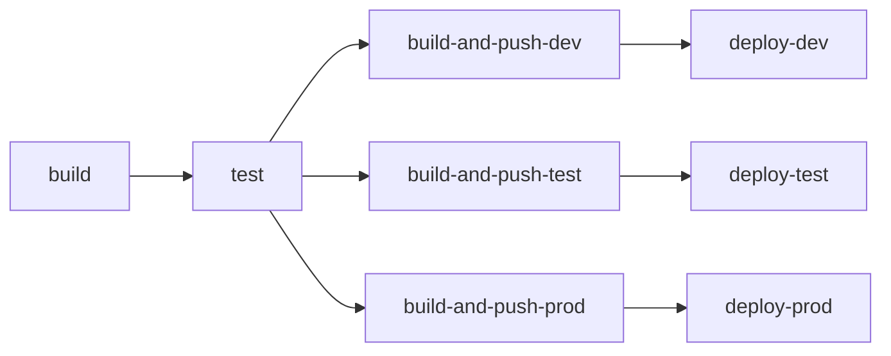

# Ćwiczenie 08.05 — GitHub Environments: dev, test i prod

## Cel i oczekiwany rezultat

Na podstawie [08-04-zmienne.yaml](../../.github/workflows/08-04-zmienne.yaml)
przygotuj workflow `.github/workflows/08-05-ENVIROMENT.yaml`.
Ma on zbudować i przetestować pogodowe API, a następnie osobno opublikować
i wdrożyć obraz dla trzech GitHub Environments: `dev`, `test` i `prod`.

Wspólne są tylko joby `build` i `test`. Każde środowisko ma własne joby
`build-and-push` oraz `deploy`. Nie używaj `matrix`.

| Environment | Tag obrazu na Docker Hub | Port hosta → kontenera | Nazwa kontenera |
| --- | --- | --- | --- |
| `dev` | `devpiotrkoska` | `18081:8000` | `pogoda_api_dev` |
| `test` | `testpiotrkoska` | `18082:8000` | `pogoda_api_test` |
| `prod` | `prodpiotrkoska` | `18083:8000` | `pogoda_api_prod` |

Wszystkie trzy aplikacje mają działać równocześnie na jednym hoście self-hosted.
Wdrożenia wykonują joby GitHub Actions, uruchamiając Docker CLI na tym hoście.



## Krok 1. Sprawdź pliki aplikacji i runnera

1. Otwórz `CWICZENIA/08-variables/pogoda_python_flusk` i sprawdź obecność
   `app.py`, `Dockerfile` oraz `requirements.txt`.
2. Zapoznaj się z workflow `08-04-zmienne.yaml`, zwłaszcza z budowaniem obrazu,
   przekazywaniem artefaktu, digestem i wymianą kontenera.
3. W **Settings → Actions → Runners** sprawdź, czy Twój runner jest dostępny
   i ma etykiety `self-hosted` oraz `linux`.
4. Runner musi mieć dostęp do Docker Engine, Docker Hub i dostawcy pogody
   oraz możliwość wykonywania poleceń `docker` i `curl`.
5. Zarezerwuj na nim trzy różne, wolne porty: `18081`, `18082`, `18083`.

## Krok 2. Utwórz nowy plik workflow

1. Skopiuj `08-04-zmienne.yaml` do `.github/workflows/08-05-ENVIROMENT.yaml`.
2. Nadaj workflow nazwę `08-05 Pogoda API — Environments`.
3. Ustaw wyzwalacze `push` i `pull_request` dla gałęzi `main`
   oraz `feature/06-pogoda-api`. Dodaj również `workflow_dispatch`.
4. Dla kroków `run` ustaw powłokę `bash`.

## Krok 3. Dodaj wspólne Repository variables

Otwórz **Settings → Secrets and variables → Actions → Variables**.
Dodaj każdą pozycję osobno przez **New repository variable**:

| Nazwa | Wartość początkowa | Do czego służy |
| --- | --- | --- |
| `WORKDIR` | `./CWICZENIA/08-variables/pogoda_python_flusk` | Katalog aplikacji i Dockerfile |
| `DOCKERHUB_USERNAME` | `piotrskoska` albo Twój login Docker Hub | Konto publikujące obrazy |
| `DOCKER_IMAGE_NAME` | `python_pogoda` | Repozytorium obrazu na Docker Hub |
| `DEPLOY_BRANCH` | `main` | Gałąź dopuszczona do publikacji i deploya |
| `WEATHER_CITY` | `Warsaw` | Miasto dla wspólnego testu CI |

W polu **Value** wpisuj samą wartość, bez dodatkowych cudzysłowów.
Jeśli korzystasz z innego konta Docker Hub, wpisz własny login i repozytorium,
do którego masz prawo publikacji.

W głównym `env` workflow odczytaj wspólne ustawienia aplikacji i obrazu.
`DEPLOY_BRANCH` odczytuj bezpośrednio z `vars` w warunkach `if` jobów publikacji.
Z loginu i nazwy repozytorium złóż `TEST_IMAGE` i `HUB_IMAGE_BASE`.
Dla wspólnego obrazu testowego ustaw `CI_TAG` na `ci-` połączone z `github.sha`.

## Krok 4. Dodaj Repository secrets

W **Settings → Secrets and variables → Actions → Secrets** dodaj lub zachowaj:

| Sekret | Wartość |
| --- | --- |
| `DOCKERHUB_TOKEN` | Twój token Docker Hub z prawem publikacji obrazu |
| `OPENWEATHER_API_KEY` | Twój klucz API OpenWeatherMap |

Sekrety odczytuj przez `secrets.*`. Ich wartości wpisz wyłącznie w ustawieniach
GitHub, bez umieszczania ich w YAML, Markdown ani logach.

Wspólny job `test` nie należy do żadnego Environment. Dlatego potrzebuje
`OPENWEATHER_API_KEY` na poziomie repozytorium, również wtedy, gdy później
dodasz osobne klucze do środowisk.

## Krok 5. Utwórz trzy GitHub Environments

1. Otwórz **Settings → Environments**.
2. Kliknij **New environment**, wpisz `dev` i wybierz **Configure environment**.
3. Wróć do listy i analogicznie utwórz `test`.
4. Powtórz operację dla `prod`.

`environment: dev` w definicji joba oznacza powiązanie z GitHub Environment.
Sam wpis `env: APP_ENV: dev` nie zastępuje tego powiązania. Konfigurację opisuje
[dokumentacja GitHub Environments](https://docs.github.com/en/actions/how-tos/deploy/configure-and-manage-deployments/manage-environments).

## Krok 6. Dodaj Environment variables

Wejdź kolejno w **Settings → Environments → dev/test/prod**.
W sekcji **Environment variables** użyj **Add variable** i dodaj w każdym
środowisku te same cztery nazwy, z wartościami z odpowiedniej kolumny:

| Environment variable | `dev` | `test` | `prod` |
| --- | --- | --- | --- |
| `IMAGE_TAG` | `devpiotrkoska` | `testpiotrkoska` | `prodpiotrkoska` |
| `APP_PORT` | `18081` | `18082` | `18083` |
| `CONTAINER_NAME` | `pogoda_api_dev` | `pogoda_api_test` | `pogoda_api_prod` |
| `WEATHER_CITY` | `Warsaw` | `Warsaw` | `Warsaw` |

`IMAGE_TAG`, `APP_PORT` i `CONTAINER_NAME` ustaw tutaj, na poziomie każdego
Environment. To właśnie te nazwy odczytuje nowe ćwiczenie.
Porty oraz nazwy kontenerów muszą być różne między środowiskami.

Przykładowo w `dev` utwórz `IMAGE_TAG` z wartością `devpiotrkoska`,
następnie `APP_PORT` z wartością `18081` itd. Powtórz dla pozostałych środowisk.

## Krok 7. Skonfiguruj sekrety środowisk, jeśli mają być różne

W sekcji **Environment secrets** danego środowiska możesz dodać
`DOCKERHUB_TOKEN` i `OPENWEATHER_API_KEY` pod tymi samymi nazwami co w repo.
Pozwala to użyć innych danych dostępowych dla każdego środowiska.

Jeśli wszystkie środowiska używają wspólnych danych, pozostaw te sekrety
na poziomie repozytorium. W kodzie nadal odczytuj je przez `secrets.*`.

## Krok 8. Zachowaj wspólny job `build`

1. Ustaw `runs-on: ubuntu-latest`.
2. Pobierz kod przez `actions/checkout@v4` i przygotuj Buildx.
3. Zbuduj obraz z `WORKDIR`, z `load: true` i `push: false`.
4. Otaguj go jako `${TEST_IMAGE}:${CI_TAG}`.
5. Zapisz obraz do `image.tar` i udostępnij artefakt `pogoda-environments-image`.

Ten job wykonuje się raz na przebieg workflow i nie ma pola `environment`.

## Krok 9. Zachowaj wspólny job `test`

1. Ustaw `needs: build` oraz `runs-on: ubuntu-latest`.
2. Pobierz artefakt i wykonaj `docker load`.
3. Uruchom tymczasowy kontener `pogoda_api_environments_ci`, z portem
   `127.0.0.1:8000:8000` i sekretem przekazanym przez `-e OPENWEATHER_API_KEY`.
4. Poczekaj na odpowiedź `/openapi.json`, ponawiając zapytania `curl`.
5. Wywołaj `/weather`, przekazując miasto przez
   `--get --data-urlencode "city=$WEATHER_CITY"`.
6. Po błędzie pokaż logi, a tymczasowy kontener usuń w kroku `if: always()`.

Job CI `test` oraz GitHub Environment o nazwie `test` to dwa odrębne elementy.

## Krok 10. Dodaj trzy joby `build-and-push`

Utwórz jawnie trzy joby:

| Job | `needs` | `environment` | Tag podstawowy |
| --- | --- | --- | --- |
| `build-and-push-dev` | `test` | `dev` | `devpiotrkoska` |
| `build-and-push-test` | `test` | `test` | `testpiotrkoska` |
| `build-and-push-prod` | `test` | `prod` | `prodpiotrkoska` |

W każdym z nich:

1. Ustaw `runs-on: ubuntu-latest` i odpowiednie `environment`.
2. Dopuść publikację tylko dla `push` lub `workflow_dispatch` na gałęzi
   zgodnej z `DEPLOY_BRANCH`. Zastosuj spójny fallback:

   ```yaml
   if: >-
     (github.event_name == 'push' || github.event_name == 'workflow_dispatch') &&
     github.ref_name == (vars.DEPLOY_BRANCH || 'main')
   ```

3. W osobnym kroku odczytaj `vars.IMAGE_TAG` przez `env` kroku. Sprawdź, czy ma
   wartość wymaganą dla tego środowiska, i zapisz ją do `$GITHUB_ENV`.
4. Pobierz kod, przygotuj Buildx i zaloguj się do Docker Hub.
5. Zbuduj i opublikuj obraz z podstawowym tagiem środowiska oraz dodatkowym
   tagiem `<tag-środowiska>-<github.sha>`.
6. Udostępnij dwa outputy joba: `image_digest` z kroku publikacji
   i `image_tag` z kroku konfiguracji.

W rezultacie publikacja buduje osobny obraz w każdym z trzech jobów,
po przejściu wspólnego CI. Dla `pull_request` wykonują się tylko `build` i `test`.

## Krok 11. Dodaj trzy joby `deploy`

| Job | `needs` | `environment` | `runs-on` |
| --- | --- | --- | --- |
| `deploy-dev` | `build-and-push-dev` | `dev` | `[self-hosted, linux]` |
| `deploy-test` | `build-and-push-test` | `test` | `[self-hosted, linux]` |
| `deploy-prod` | `build-and-push-prod` | `prod` | `[self-hosted, linux]` |

Każdy deploy ma pobierać digest i tag z outputów swojego joba publikującego.
Przykład dla `dev`:

```yaml
env:
  TARGET_ENVIRONMENT: dev
  IMAGE_DIGEST: ${{ needs.build-and-push-dev.outputs.image_digest }}
  IMAGE_TAG: ${{ needs.build-and-push-dev.outputs.image_tag }}
```

Wszystkie deploye trafiają na Twój jeden runner. Pary środowisk są niezależne:
`deploy-prod` nie zależy od `deploy-dev` ani `deploy-test`.

## Krok 12. Odczytaj i sprawdź konfigurację deploya

Na początku każdego deploya dodaj krok z własnym `env`, odczytujący
`vars.APP_PORT`, `vars.CONTAINER_NAME`, `vars.WEATHER_CITY`
oraz `secrets.OPENWEATHER_API_KEY`.

1. Sprawdź, czy port, nazwa kontenera, digest, tag i klucz API nie są puste.
2. Zweryfikuj, czy port jest liczbą od `1` do `65535`.
3. Dla nazwy kontenera dopuść litery, cyfry, `_` i `-`, z literą lub cyfrą
   na początku, aby móc bezpiecznie użyć dokładnego filtra nazwy.
4. Zapisz `APP_PORT`, `CONTAINER_NAME`, `WEATHER_CITY` i wyliczony
   `API_BASE_URL=http://127.0.0.1:<port>` do `$GITHUB_ENV` dla następnych kroków.
5. Wypisz nazwę środowiska, obraz, tag, port i nazwę kontenera, bez sekretów.

Konfigurację Environment odczytuj w krokach po starcie joba; wspólny główny
`env` służy tu ustawieniom repozytorium. Zobacz
[dostępność zmiennych środowisk](https://docs.github.com/en/actions/reference/workflows-and-actions/contexts#vars-context).

## Krok 13. Pobierz obraz i zastąp kontener danego środowiska

W każdym deployu wykonaj kolejno:

1. Logowanie do Docker Hub.
2. `docker pull` obrazu po digescie otrzymanym z właściwego publishera.
3. Wyszukanie istniejącego kontenera po pełnej nazwie `CONTAINER_NAME`,
   również gdy jest zatrzymany.
4. Usunięcie znalezionego kontenera. Błąd usuwania ma zatrzymać job.
5. Uruchomienie nowego kontenera z tą nazwą, `--restart unless-stopped`,
   mapowaniem `${APP_PORT}:8000` oraz `-e OPENWEATHER_API_KEY`.

Użycie digestu wiąże deploy z obrazem opublikowanym w tym przebiegu,
nawet gdy ktoś później nadpisze podstawowy tag środowiska.

## Krok 14. Sprawdź API po każdym deployu

1. Przez `curl` odpytaj `$API_BASE_URL/openapi.json`, z ograniczonym ponawianiem
   także po zerwaniu połączenia.
2. Sprawdź `docker inspect`, czy kontener jest uruchomiony.
3. Wywołaj `$API_BASE_URL/weather` z miastem podanym przez `--data-urlencode`.
4. Błąd zapytania ma zakończyć job niepowodzeniem i uruchomić krok z logami.
5. Po zakończeniu joba pozostaw kontener działający na hoście.

W `run` używaj składni Bash, np. `${HUB_IMAGE_BASE}` i `$CONTAINER_NAME`.
W polach akcji używaj `${{ env.NAZWA }}`. Zapis `${env.NAZWA}` powoduje
błąd `bad substitution` i nie jest poprawnym odczytem zmiennej w Bashu.

## Krok 15. Rozdziel współbieżność środowisk

Każdy job publikujący i wdrażający ma dostać własną grupę `concurrency`,
np. `pogoda-env-publish-dev` oraz `pogoda-env-deploy-dev`, analogicznie dla
`test` i `prod`. Ustaw `cancel-in-progress: false`.

Użyj sześciu odrębnych grup. Nie uzależniaj wszystkich trzech środowisk
od jednej wspólnej grupy. Jeden runner wykona dostępne joby deploy kolejno,
zachowując kontenery wcześniej wdrożonych środowisk.

## Krok 16. Udostępnij workflow i uruchom pełny przebieg

1. Sprawdź, czy `DEPLOY_BRANCH=main` i wszystkie Environment variables
   mają wartości zgodne z tabelami.
2. Udostępnij przygotowane pliki na GitHub na gałęzi `main`.
3. Sprawdź przebieg wyzwolony przez `push` lub wybierz w **Actions** workflow
   `08-05 Pogoda API — Environments`, kliknij **Run workflow** i wybierz `main`.
4. Dla ręcznego startu plik z `workflow_dispatch` musi być dostępny na domyślnej
   gałęzi repozytorium. Zobacz
   [instrukcję ręcznego uruchamiania](https://docs.github.com/en/actions/how-tos/manage-workflow-runs/manually-run-a-workflow).
5. Potwierdź osiem poprawnie zakończonych jobów i trzy podstawowe tagi na Docker Hub.
6. Na hoście runnera sprawdź działanie aplikacji na portach `18081`, `18082`
   i `18083`. Adres `127.0.0.1` w testach workflow oznacza host runnera.

## Krok 17. Sprawdź ponowny deploy i niezależność konfiguracji

1. Zanotuj identyfikatory trzech kontenerów na hoście runnera.
2. Uruchom workflow ponownie i sprawdź, że każdy deploy zastąpił kontener
   własnego środowiska. Po zakończeniu ponownie działają wszystkie trzy aplikacje.
3. Zmień `WEATHER_CITY` tylko w Environment `dev`, np. na `Gdansk`.
4. Uruchom nowy przebieg i sprawdź, że test po deployu `dev` użył nowego miasta,
   a pozostałe środowiska zachowały własną konfigurację.
5. Sprawdź przebieg `pull_request`: publikacja i deploye mają być pominięte,
   a wspólny build i test wykonane.

## Kryteria ukończenia

- Workflow zawiera osiem jawnych jobów, bez `matrix`.
- `build` i `test` wykonują się wspólnie, a każda para publikacji i deploya
  ma przypisane odpowiednie GitHub Environment.
- Podstawowe tagi to dokładnie `devpiotrkoska`, `testpiotrkoska`, `prodpiotrkoska`.
- Trzy kontenery działają na jednym hoście, z różnymi portami i nazwami.
- Każdy deploy używa digestu właściwego obrazu i przechodzi test `/weather`.
- Ponowne wykonanie zastępuje kontenery, a aplikacje pozostają uruchomione po jobach.
- Konfiguracja pochodzi z właściwych Variables, a tokeny i klucze z Secrets.

Gotowe rozwiązanie: [08-05-ENVIROMENT.yaml](../../.github/workflows/08-05-ENVIROMENT.yaml).
