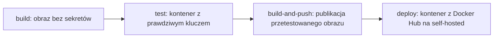

# FAZA-1 — Od obrazu Docker do działającej aplikacji pogodowej

## Zadanie i rezultat

Przygotuj pipeline GitHub Actions, który kolejno:

1. Buduje obraz aplikacji.
2. Uruchamia zbudowany kontener i testuje WWW oraz API z **prawdziwym kluczem OpenWeatherMap**.
3. Publikuje na Docker Hub dokładnie ten obraz, który przeszedł test.
4. Pobiera opublikowany obraz i uruchamia go na runnerze self-hosted.

Wynikiem ma być aplikacja dostępna pod `http://ADRES_RUNNERA:18090/`.
Użytkownik wpisuje w WWW wyłącznie nazwę miasta. API również przyjmuje tylko
miasto, np. `/api/weather?city=Warsaw`.

Obraz łączy **Nginx i Python/FastAPI**. Nginx przyjmuje ruch HTTP na porcie
`8080` kontenera, a Python nasłuchuje tylko na `127.0.0.1:8000` wewnątrz niego.
Domyślnym protokołem jest HTTP. Ten sam obraz może obsłużyć opcjonalny HTTPS
na `8443`, po dostarczeniu certyfikatu i klucza przy uruchomieniu.



## Krok 1. Przygotuj aplikację i konta

1. Otwórz katalog `CWICZENIA/15A-Cwiczenia-pipeline-gha/pogoda_python_flusk`.
2. Zapoznaj się z `app.py`, plikami `static/`, `Dockerfile`, `.dockerignore`,
   `start-container.sh`, konfiguracją `nginx/` i `tests/smoke_test.py`.
3. Sprawdź, czy repozytorium Docker Hub `piotrskoska/python_pogoda` istnieje
   i czy masz prawo publikować w nim obrazy. Przy pracy na własnym koncie
   użyj swojego loginu i repozytorium.
4. Przygotuj aktywny klucz API OpenWeatherMap oraz token Docker Hub
   z prawem publikacji obrazu.
5. W **Settings → Actions → Runners** sprawdź dostępność runnera z etykietami
   `self-hosted` i `linux`. Musi on mieć Docker, Python 3 i `curl`, dostęp do
   Docker Hub i OpenWeatherMap oraz wolny port `18090`.

W tym ćwiczeniu `ubuntu-latest` buduje i testuje obraz `linux/amd64`.
Runner wdrożeniowy musi obsługiwać tę samą architekturę obrazu.

## Krok 2. Dodaj Repository variables w GitHub

Otwórz **Settings → Secrets and variables → Actions → Variables**.
Przyciskiem **New repository variable** utwórz każdą pozycję osobno:

| Nazwa | Wartość początkowa | Znaczenie |
| --- | --- | --- |
| `DOCKERHUB_USERNAME` | `piotrskoska` | Login Docker Hub; przy własnym koncie wpisz własny login |
| `DOCKER_IMAGE_NAME` | `python_pogoda` | Repozytorium obrazu na Docker Hub |
| `FAZA1_IMAGE_TAG` | `faza1` | Podstawowy tag publikowanego obrazu |
| `FAZA1_APP_PORT` | `18090` | Port HTTP na hoście runnera |
| `FAZA1_CONTAINER_NAME` | `pogoda_api_faza1` | Stała nazwa wdrażanego kontenera |
| `FAZA1_WEATHER_CITY` | `Warsaw` | Miasto używane w rzeczywistym teście API |
| `FAZA1_DEPLOY_BRANCH` | `main` | Gałąź dopuszczona do publikacji i deploya |

W **Value** wpisuj samą wartość, bez dodatkowych cudzysłowów.
Workflow zawiera te same wartości domyślne i ich opis w komentarzach.
W tym zadaniu nie musisz tworzyć GitHub Environments.

## Krok 3. Dodaj Repository secrets

Przejdź do **Settings → Secrets and variables → Actions → Secrets**
i użyj **New repository secret**:

| Nazwa | Co wpisać jako wartość | Zastosowanie |
| --- | --- | --- |
| `DOCKERHUB_TOKEN` | Twój prawdziwy token Docker Hub z prawem publikacji | Logowanie podczas publikacji i deploya |
| `OPENWEATHER_API_KEY` | Twój prawdziwy, aktywny klucz API OpenWeatherMap | Pobieranie pogody przez uruchomiony kontener |

Sekretów nie wpisuj do Dockerfile, YAML, JavaScriptu, Markdown ani URL zapytań.
Nie przekazuj klucza do `docker build`, `build-args` ani konfiguracji akcji
budującej obraz. Jest on potrzebny dopiero podczas `docker run`.

W tej fazie nie jest używany sztuczny klucz ani zastępczy dostawca pogody.
Brak klucza, klucz nieaktywny lub błędny, przekroczony limit albo brak połączenia
z OpenWeatherMap mają zakończyć rzeczywisty test niepowodzeniem.

## Krok 4. Sprawdź rozdzielenie obrazu i konfiguracji uruchomienia

1. Dockerfile ma instalować zależności Pythona i Nginx oraz kopiować kod,
   pliki interfejsu i konfigurację serwera.
2. Nie dodawaj do niego `ARG OPENWEATHER_API_KEY` ani
   `ENV OPENWEATHER_API_KEY=...`.
3. `.dockerignore` ma wykluczać lokalne `.env`, certyfikaty, klucze prywatne
   i inne pliki z danymi dostępowymi z kontekstu budowania.
4. Klucz aplikacja odczytuje ze środowiska procesu. Przekazanie następuje przy
   `docker run`, przez `-e OPENWEATHER_API_KEY`.
5. Nginx jest jedynym wejściem do WWW i API. Nie publikuj wewnętrznego
   portu Pythona `8000` na hoście.

Przeglądarka i klient API nie potrzebują znać klucza OpenWeatherMap.
Samo uruchomienie obrazu nie powinno wymagać ponownego budowania go z kluczem.

## Krok 5. Utwórz plik workflow

1. W katalogu `.github/workflows` utwórz `15A-FAZA-1-pogoda.yaml`.
2. Nadaj workflow nazwę `15A FAZA-1 — Pogoda WWW i API`.
3. Dodaj `workflow_dispatch`, aby uruchamiać go z zakładki **Actions**.
4. Dodaj `push` na `main`, ograniczony do zmian katalogu aplikacji i tego YAML.
5. Dla kroków `run` wybierz `shell: bash`.

Ten pipeline uruchamia rzeczywisty test korzystający z sekretu. W tej fazie
nie konfiguruj `pull_request_target` ani uruchamiania niezweryfikowanego kodu
z forków z dostępem do sekretów.

## Krok 6. Zdefiniuj wspólne ustawienia workflow

W głównym `env` ustaw:

- `APP_DIR` na `./CWICZENIA/15A-Cwiczenia-pipeline-gha/pogoda_python_flusk`;
- `HUB_IMAGE_BASE` z loginu Docker Hub i nazwy obrazu, domyślnie
  `piotrskoska/python_pogoda`;
- `CI_IMAGE` jako ten sam obraz z tagiem `ci-<github.sha>`;
- `IMAGE_TAG`, `APP_PORT`, `CONTAINER_NAME`, `WEATHER_CITY` z odpowiednich
  zmiennych `FAZA1_*`.

`APP_DIR`, `HUB_IMAGE_BASE`, `CI_IMAGE` oraz digest są wartościami ustawianymi
lub obliczanymi przez workflow. Nie dodawaj ich jako kolejnych Variables.

W polach akcji używaj `${{ env.NAZWA }}`. W poleceniach Bash używaj
`$NAZWA` lub `${NAZWA}`, z cudzysłowami. Zapis `${env.NAZWA}` jest błędny.

## Krok 7. Dodaj job `build`

1. Ustaw `runs-on: ubuntu-latest`.
2. Pobierz kod przez `actions/checkout@v4`.
3. Przygotuj Buildx przez `docker/setup-buildx-action@v3`.
4. Użyj `docker/build-push-action@v6` z kontekstem `APP_DIR`, tagiem `CI_IMAGE`,
   `load: true` i `push: false`.
5. Nie przekazuj temu jobowi klucza OpenWeatherMap.
6. Sprawdź metadane obrazu: jego `Config.Env` nie może zawierać ustawionego
   `OPENWEATHER_API_KEY`.
7. Zapisz obraz poleceniem `docker save "$CI_IMAGE" -o image.tar`.
8. Przekaż `image.tar` jako artefakt `faza1-weather-image`
   przez `actions/upload-artifact@v4`.

Job buduje obraz, ale jeszcze nie publikuje go w rejestrze.

## Krok 8. Dodaj zależność joba `test`

1. Ustaw `runs-on: ubuntu-latest` oraz `needs: build`.
2. Pobierz kod, aby mieć dostęp do `tests/smoke_test.py`.
3. Pobierz artefakt przez `actions/download-artifact@v4`.
4. Wykonaj `docker load -i image.tar`.

Test ma wykorzystywać obraz z poprzedniego joba. Nie buduj drugiego obrazu
na potrzeby testowania.

## Krok 9. Uruchom kontener testowy z prawdziwym kluczem

W kroku uruchamiającym kontener zdefiniuj:

```yaml
env:
  OPENWEATHER_API_KEY: ${{ secrets.OPENWEATHER_API_KEY }}
```

Następnie:

1. Sprawdź, czy zmienna nie jest pusta. Nie wypisuj jej wartości.
2. Uruchom `CI_IMAGE` jako kontener `pogoda_api_faza1_ci`.
3. Opublikuj port wyłącznie lokalnie na runnerze: `127.0.0.1:18090:8080`.
4. Przekaż klucz opcją `-e OPENWEATHER_API_KEY`, bez wpisywania jego wartości
   do polecenia zapisanego w YAML.
5. Czekaj przez `curl` na `http://127.0.0.1:18090/healthz`, z ograniczonym
   ponawianiem zapytania także po zerwaniu połączenia.

`/healthz` sprawdza działanie aplikacji. Sprawdzenie prawdziwego dostawcy pogody
następuje w kolejnym kroku.

## Krok 10. Przetestuj WWW i rzeczywiste API

Uruchom przygotowany test:

```bash
python3 "${APP_DIR}/tests/smoke_test.py" \
  --base-url http://127.0.0.1:18090 \
  --city "$WEATHER_CITY"
```

Test ma sprawdzić stronę WWW, pliki interfejsu, gotowość aplikacji,
definicję API oraz poprawną odpowiedź pogodową pochodzącą z OpenWeatherMap.
Samo `200 OK` na stronie startowej nie potwierdza poprawności klucza API.

Po błędzie pokaż logi kontenera. W kroku `if: always()` usuń kontener testowy.
Nie stosuj `continue-on-error`, pomijania testów ani danych pogodowych na sztywno.

## Krok 11. Dodaj job `build-and-push`

1. Ustaw `runs-on: ubuntu-latest` i `needs: test`.
2. Zezwól na publikację tylko dla `push` lub `workflow_dispatch`, na gałęzi
   zgodnej z `vars.FAZA1_DEPLOY_BRANCH || 'main'`.
3. Pobierz i załaduj ten sam artefakt `image.tar`.
4. Zaloguj się przez `docker/login-action@v3`, używając loginu z `env`
   i sekretu `DOCKERHUB_TOKEN`.
5. Nadaj obrazowi tagi `faza1` oraz `faza1-<github.sha>`
   albo odpowiedniki wynikające z `FAZA1_IMAGE_TAG`.
6. Wykonaj `docker push` obu tagów.
7. Odczytaj digest z potwierdzenia własnego `docker push` i przekaż go jako
   output `image_digest`. Brak jednoznacznego digestu ma zakończyć job błędem.

Mimo nazwy joba ten etap **nie przebudowuje obrazu**. Publikuje dokładnie ten,
który został zapisany w `build` i uruchomiony w `test`.

## Krok 12. Przygotuj job `deploy`

1. Ustaw `runs-on: [self-hosted, linux]` oraz `needs: build-and-push`.
2. Dodaj grupę `concurrency: pogoda-faza1-deploy` z
   `cancel-in-progress: false`, aby dwa przebiegi nie wymieniały kontenera naraz.
3. Przed logowaniem utwórz prywatny katalog tymczasowy przez
   `mktemp -d "${RUNNER_TEMP}/faza1-docker-config.XXXXXX"`, ustaw prawa `700`
   i przekaż jego ścieżkę jako `DOCKER_CONFIG` przez `$GITHUB_ENV`.
   Dzięki temu job używa własnego pliku poświadczeń Dockera na self-hosted runnerze.
4. Pobierz kod z helperem testowym.
5. Pobierz `IMAGE_DIGEST` z outputu publikacji.
6. Zanim zmienisz istniejący kontener, sprawdź port, nazwę kontenera,
   digest, miasto i obecność sekretu API.
7. Złóż `IMAGE_REFERENCE` jako `${HUB_IMAGE_BASE}@${IMAGE_DIGEST}`
   i udostępnij ją kolejnym krokom przez `$GITHUB_ENV`.

Digest wskazuje obraz z tego przebiegu. Nadpisanie tagu `faza1` przez inny
przebieg nie zmienia obrazu wybranego do tego deploya.

## Krok 13. Wymień kontener na hoście self-hosted

Wykonaj kolejno:

1. Zaloguj się do Docker Hub.
2. Pobierz opublikowany obraz przez `docker pull "$IMAGE_REFERENCE"`.
3. Wyszukaj istniejący kontener po **pełnej nazwie** `CONTAINER_NAME`,
   uwzględniając także kontenery zatrzymane.
4. Jeśli istnieje, usuń go przez `docker rm --force`.
5. Uruchom nowy z `--restart unless-stopped`, portem `${APP_PORT}:8080`
   oraz kluczem przekazanym przez `-e OPENWEATHER_API_KEY`.

Pobieranie ma nastąpić przed usunięciem poprzedniego kontenera.
Nie ignoruj błędu usunięcia. Po zakończeniu joba pozostaw aplikację uruchomioną.

## Krok 14. Zweryfikuj deploy

1. Poczekaj na `/healthz` pod `http://127.0.0.1:<APP_PORT>`.
2. Przez `docker inspect` potwierdź, że kontener jest uruchomiony.
3. Ponownie uruchom `tests/smoke_test.py`, tym razem przeciwko kontenerowi
   pobranemu z Docker Hub.
4. Po błędzie pokaż logi kontenera i zakończ job niepowodzeniem.
5. Na samym końcu dodaj krok `if: always()`: wykonaj `docker logout`, usuń
   `config.json` z utworzonego katalogu `DOCKER_CONFIG` i usuń pusty katalog.
   Sprzątaj tylko ścieżkę o prefiksie `${RUNNER_TEMP}/faza1-docker-config.`.
   W akcji logowania joba `deploy` ustaw `logout: false`, ponieważ wylogowanie
   obsługuje ten jawny krok. Sprzątanie ma wykonać się także po nieudanym deployu.

Test po deployu również ma pobrać prawdziwą pogodę. Test nie korzysta
z klucza w URL ani w argumentach helpera — klucz zna wyłącznie kontener.
Usuwane są lokalne poświadczenia logowania do rejestru. Sekrety w ustawieniach
GitHub oraz klucz pogodowy działającego kontenera pozostają dostępne do swojego celu.

## Krok 15. Udostępnij pliki i uruchom workflow

1. Sprawdź listę zmian. Upewnij się, że nie obejmuje plików z prawdziwymi
   kluczami, tokenami, `.env` ani kluczem prywatnym TLS.
2. Udostępnij kod aplikacji i YAML na GitHub na gałęzi `main`.
3. Przejdź do **Actions → 15A FAZA-1 — Pogoda WWW i API**.
4. Wybierz **Run workflow**, gałąź `main` i uruchom przebieg.
5. Obserwuj kolejność `build` → `test` → `build-and-push` → `deploy`.
6. Gdy zmienisz `FAZA1_DEPLOY_BRANCH`, dostosuj również jawny filtr gałęzi
   w `on.push.branches` albo uruchamiaj ręcznie właściwą gałąź.

Przycisk ręcznego uruchomienia wymaga pliku z `workflow_dispatch` na domyślnej
gałęzi repozytorium. Błędny klucz lub niedostępny dostawca mają zatrzymać test,
a kolejne joby muszą zostać pominięte.

## Krok 16. Sprawdź rezultat jako użytkownik

1. Otwórz `http://ADRES_RUNNERA:18090/` z urządzenia mającego dostęp do tego hosta.
2. Wpisz miasto, np. `Warsaw` lub `Gdańsk`, i wyświetl pogodę.
3. Otwórz `http://ADRES_RUNNERA:18090/docs`, aby zapoznać się z API.
4. Wywołaj API bez podawania klucza:

   ```bash
   curl --fail --get --data-urlencode 'city=Warsaw' \
     http://ADRES_RUNNERA:18090/api/weather
   ```

5. Uruchom workflow ponownie. Kontener `pogoda_api_faza1` ma zostać zastąpiony,
   a aplikacja pozostać dostępna po zakończeniu joba.

Adres `127.0.0.1` w jobie `deploy` oznacza runner self-hosted. We własnej
przeglądarce użyj adresu tego hosta. Dostęp do portu musi dopuszczać jego sieć
i zapora.

## Krok 17. Opcjonalnie uruchom ten sam obraz z HTTPS

Domyślny pipeline nie wymaga certyfikatu i wdraża HTTP. HTTPS można uruchomić
z tego samego opublikowanego obrazu, bez budowania go ponownie.

Przykład szkoleniowy do wykonania lokalnie na hoście z Dockerem:

1. W prywatnym katalogu poza repozytorium utwórz `tls/` i przygotuj certyfikat
   z kluczem. Dla testu na `localhost` możesz użyć:

   ```bash
   mkdir -m 700 tls
   openssl req -x509 -newkey rsa:2048 -nodes -days 7 \
     -subj '/CN=localhost' \
     -addext 'subjectAltName=DNS:localhost,IP:127.0.0.1' \
     -keyout tls/key.pem -out tls/cert.pem
   chmod 600 tls/key.pem
   ```

2. Zwykłym kontem użytkownika odczytaj klucz pogodowy do środowiska terminala,
   bez wpisywania go w historii poleceń:

   ```bash
   read -r -s -p 'Klucz OpenWeatherMap: ' OPENWEATHER_API_KEY
   export OPENWEATHER_API_KEY
   printf '\n'
   ```

3. Uruchom osobny kontener z plikami zamontowanymi tylko do odczytu:

   ```bash
   docker run -d \
     --name pogoda_api_faza1_https \
     --user "$(id -u):$(id -g)" \
     --restart unless-stopped \
     -p 18091:8080 -p 18443:8443 \
     --mount "type=bind,source=$(pwd)/tls,target=/run/tls,readonly" \
     -e OPENWEATHER_API_KEY \
     -e TLS_CERT_FILE=/run/tls/cert.pem \
     -e TLS_KEY_FILE=/run/tls/key.pem \
     piotrskoska/python_pogoda:faza1
   ```

   Dopasowanie użytkownika kontenera do właściciela plików pozwala odczytać
   prywatny klucz z prawami `0600`. Ten przykład pozostawia również HTTP
   na osobnym porcie `18091`.

4. Sprawdź HTTPS z weryfikacją certyfikatu:

   ```bash
   curl --fail --cacert tls/cert.pem \
     'https://localhost:18443/api/weather?city=Warsaw'
   ```

5. Dla dostępu pod nazwą hosta użyj certyfikatu wystawionego dla tej nazwy
   i zadbaj o jej poprawne rozwiązywanie w DNS. Certyfikat dla `localhost`
   nie potwierdza tożsamości innej nazwy ani adresu hosta.

`TLS_CERT_FILE` i `TLS_KEY_FILE` zawierają ścieżki do zamontowanych plików,
a nie zawartość certyfikatu lub klucza. Nie dodawaj klucza prywatnego do obrazu,
artefaktu CI ani Git. Nie wyłączaj weryfikacji TLS przez `curl -k`.

## Kryteria ukończenia

- WWW i API wymagają od użytkownika tylko nazwy miasta.
- Jeden obraz zawiera Nginx i Python, z domyślnym HTTP i opcjonalnym HTTPS.
- Obraz nie zawiera klucza API; jest on przekazywany dopiero przy `docker run`.
- Test kontenera sprawdza rzeczywiste dane OpenWeatherMap z prawdziwym kluczem.
- Publikacja następuje wyłącznie po poprawnym teście i nie przebudowuje obrazu.
- Deploy pobiera opublikowany obraz po digescie i zastępuje istniejący kontener.
- Po deployu przechodzą test WWW i prawdziwego API, a kontener pozostaje uruchomiony.

Gotowe rozwiązanie pipeline: [15A-FAZA-1-pogoda.yaml](../../../.github/workflows/15A-FAZA-1-pogoda.yaml).
